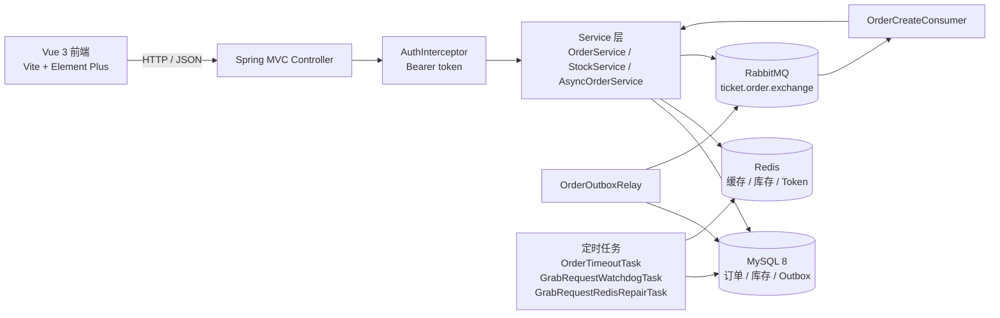
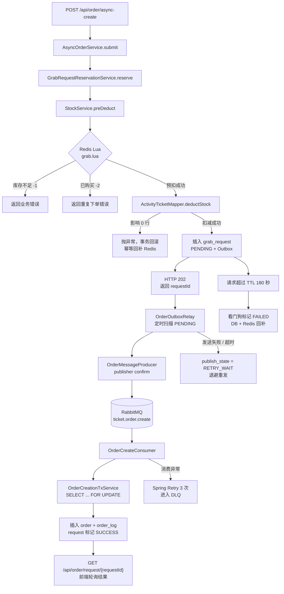

# 校园活动抢票平台

一个基于 Spring Boot、MySQL、Redis、RabbitMQ 和 Vue 3 的校园活动抢票系统。

项目重点不是“做一个活动页面”，而是处理抢票场景中的几个真实问题：

- 高并发请求下的库存超卖
- 同一用户重复购买同一活动
- 热点活动详情缓存击穿
- 同步下单对 Web 线程的占用
- RabbitMQ 异步下单中的消息丢失、重复消费、消费失败和库存补偿

当前同时保留两条下单链路：

- **同步下单**：`POST /api/order/create`，适合本地验证和小流量场景
- **异步下单**：`POST /api/order/async-create`，请求先落库预留库存，再由 RabbitMQ 消费者建单

支付接口目前是**模拟支付**，不是真实支付网关。

---

## 目录

- [1. 项目能力](#1-项目能力)
- [2. 技术栈](#2-技术栈)
- [3. 系统架构](#3-系统架构)
- [4. 核心抢票流程](#4-核心抢票流程)
- [5. Redis + Lua 的原子库存操作](#5-redis--lua-的原子库存操作)
- [6. 并发、幂等与库存一致性](#6-并发幂等与库存一致性)
- [7. 订单生命周期](#7-订单生命周期)
- [8. 项目结构](#8-项目结构)
- [9. 接口清单](#9-接口清单)
- [10. 数据库与索引](#10-数据库与索引)
- [11. 配置与启动](#11-配置与启动)
- [12. 接口调用示例](#12-接口调用示例)
- [13. 测试与验证结果](#13-测试与验证结果)
- [14. 已知限制与后续优化](#14-已知限制与后续优化)
- [15. 面试可展开的技术点](#15-面试可展开的技术点)

---

## 1. 项目能力

### 用户端

- 注册、登录、登出
- 活动列表和活动详情
- 选择票种、数量并抢票
- 同步下单
- RabbitMQ 异步下单和请求状态轮询
- 我的订单、模拟支付

### 管理端

- 发布活动
- 为活动新增票种并初始化 Redis 库存
- 按订单状态查询订单
- 核销已支付订单

### 基础设施层面的实现

- 活动详情、票种详情 Redis 缓存
- 互斥锁防止缓存击穿
- Redis Lua 原子预扣库存
- MySQL 条件更新防止超卖
- 数据库唯一索引防止重复订单
- RabbitMQ Outbox 异步建单
- Publisher Confirm、消费重试、死信队列
- 异步请求看门狗和 Redis 库存回补修复
- 订单状态机和订单状态日志
- 定时关闭超时未支付订单并回补库存

---

## 2. 技术栈

| 技术 | 实际用途 |
| --- | --- |
| Java 17 | 项目运行版本 |
| Spring Boot 2.7.18 | Web、事务、拦截器、定时任务 |
| MyBatis-Plus 3.5.3.2 | CRUD、条件更新、行锁查询 |
| MySQL 8 | 用户、活动、票种、订单、订单日志、异步请求的最终数据源 |
| Redis | 缓存、库存预扣、买家集合、限流、登录 token、幂等回补标记 |
| RabbitMQ + Spring AMQP | 异步建单、发布确认、DLX/DLQ、消费重试（本地验证使用 4.4） |
| Spring Retry | 消费者失败重试 |
| Spring Security Crypto | BCrypt 密码哈希 |
| Lombok | 实体和依赖注入简化 |
| Vue 3.4 + Vite 5 | 前端页面和开发服务器 |
| Element Plus 2.7 | 前端组件 |
| Axios | 前端 HTTP 请求和轮询 |

---

## 3. 系统架构



关键点：

- MySQL 是最终数据源。
- Redis 用于缓存和库存预扣，不是最终账本。
- RabbitMQ 只负责传递异步建单消息，可靠性由 Outbox、消费幂等、重试和看门狗共同保证。
- 登录 token 是 Redis 中的随机值，不是 JWT。

### RabbitMQ 拓扑

| 类型 | 名称 | 说明 |
| --- | --- | --- |
| Exchange | `ticket.order.exchange` | direct、durable |
| Queue | `ticket.order.create` | 绑定 routing key `order.create` |
| DLX | `ticket.order.dlx` | 消费重试耗尽后的死信交换机 |
| DLQ | `ticket.order.create.dlq` | 死信队列，当前没有自动消费者 |

---

## 4. 核心抢票流程

### 异步下单



### 同步下单

同步链路更短：

```text
POST /api/order/create
→ StockService.preDeduct（Redis Lua）
→ ActivityTicketMapper.deductStock（DB 条件更新）
→ OrderMapper.insert
→ order_log
→ 返回订单 ID
```

失败时：

```text
数据库事务回滚
→ 按 token 幂等回补 Redis
```

---

## 5. Redis + Lua 的原子库存操作

### 5.1 预扣脚本

文件：`backend/src/main/resources/lua/grab.lua`

```lua
if redis.call('SISMEMBER', KEYS[2], ARGV[1]) == 1 then
    return -2
end

local stock = tonumber(redis.call('GET', KEYS[1]) or '-1')
if stock < tonumber(ARGV[2]) then
    return -1
end

redis.call('DECRBY', KEYS[1], ARGV[2])
redis.call('SADD', KEYS[2], ARGV[1])

return stock - tonumber(ARGV[2])
```

参数约定：

| 参数 | 含义 |
| --- | --- |
| `KEYS[1]` | `ticket:stock:{ticketId}` |
| `KEYS[2]` | `ticket:buyers:{ticketId}` |
| `ARGV[1]` | `userId` |
| `ARGV[2]` | `count` |

返回值：

| 返回值 | 含义 |
| --- | --- |
| `>= 0` | 预扣成功，返回剩余库存 |
| `-1` | 库存不足，或库存 key 未初始化 |
| `-2` | 该用户已经购买过该票种 |

Redis 执行 Lua 时不会被其他命令插入，因此**判断重复购买、判断库存、扣减库存、记录买家**在一次脚本中原子完成。

注意：`ticket:buyers` 是**按票种**记录的，而数据库唯一索引是**按活动 + 用户**约束的。同一活动不同票种的并发重复请求，最终由数据库唯一索引兜底。

### 5.2 数据库最终防超卖

文件：`backend/src/main/java/com/ticket/platform/mapper/ActivityTicketMapper.java`

```sql
UPDATE activity_ticket
SET stock = stock - #{count}
WHERE id = #{ticketId} AND stock >= #{count}
```

即使 Redis 库存判断出现偏差，数据库也不会扣成负数。**Redis 是流量前置层，MySQL 条件更新是最终防线。**

### 5.3 幂等回补

文件：`backend/src/main/resources/lua/grab_rollback_idempotent.lua`

```lua
if redis.call('SETNX', KEYS[3], '1') == 0 then
    return 0
end

redis.call('EXPIRE', KEYS[3], ARGV[3])
redis.call('INCRBY', KEYS[1], ARGV[2])
redis.call('SREM', KEYS[2], ARGV[1])
return 1
```

`KEYS[3]` 是 `ticket:rollback:{token}`。同一个 token 重复回补时，只有第一次会真正增加库存，避免补偿逻辑重复执行把库存加多。

当前主流程使用的是幂等回滚脚本。仓库里还保留了旧版 `grab_rollback.lua`，当前 `StockService` 不依赖它。

### 5.4 相关 Redis key

| key | 用途 |
| --- | --- |
| `ticket:stock:{ticketId}` | 库存预扣计数 |
| `ticket:buyers:{ticketId}` | 已购买用户集合 |
| `ticket:rollback:{token}` | Redis 回补幂等标记 |
| `activity:detail:{activityId}` | 活动详情缓存 |
| `activity:lock:{activityId}` | 活动详情缓存互斥锁 |
| `ticket:detail:{ticketId}` | 票种详情缓存 |
| `ticket:lock:{ticketId}` | 票种详情缓存互斥锁 |
| `rate:activity:{activityId}:{userId}` | 单用户单活动限流 |
| `auth:token:{token}` | 登录 token |

---

## 6. 并发、幂等与库存一致性

### 6.1 防止超卖

三层：

1. Redis Lua 原子预扣，先挡掉大部分无效请求。
2. MySQL `stock >= count` 条件更新，数据库层面保证库存不为负。
3. 失败时数据库事务回滚，并通过幂等 token 回补 Redis。

### 6.2 防止重复下单

同步路径：

- 数据库预检查 `user_id + activity_id` 是否已有订单
- Redis `ticket:buyers:{ticketId}` 拦截同一票种重复购买
- 数据库唯一索引 `uk_user_activity` 作为最终约束

异步路径：

- 客户端生成 `requestId`
- `grab_request.request_id` 唯一
- `order.request_id` 唯一
- 同一请求再次消费时读取到 `SUCCESS` / `FAILED` 后直接返回
- 消费者使用 `SELECT ... FOR UPDATE` 行锁

需要注意：`uk_user_activity` 不区分订单状态。即使用户的订单已经取消，当前实现仍不允许再次购买同一活动。这是一个业务限制，见“已知限制”。

### 6.3 异步下单的 Outbox

`grab_request` 同时承担两件事：

- 幂等请求记录
- 事务性 Outbox

异步预留事务大致是：

```text
检查 requestId / 重复订单 / 活跃请求
→ Redis 预扣
→ DB 条件扣库存
→ 插入 grab_request(PENDING, publish_state=NEW, expire_time=now+180s)
→ 同一事务提交
```

这样即使数据库提交后应用立即崩溃，请求记录仍然存在，`OrderOutboxRelay` 可以继续发布消息。

### 6.4 消息发布可靠性

`OrderOutboxRelay` 定时扫描 PENDING 请求：

- 条件抢占发布权
- `OrderMessageProducer` 使用 publisher confirm
- 发送成功：`publish_state = CONFIRMED`
- 发送失败或超时：`publish_state = RETRY_WAIT`，按退避时间重发
- 请求仍未成功时，按 `republish-interval-seconds` 重新发布

重复消息由消费者幂等处理，不依赖“MQ 只投递一次”。

### 6.5 消费幂等

`OrderCreationTxService` 在一个事务中：

1. `SELECT ... FOR UPDATE` 读取请求
2. 已 SUCCESS / FAILED：直接返回
3. 已过期：返回，交给看门狗
4. 检查 `order.request_id` 是否已有订单
5. 检查同用户同活动是否已有订单
6. 插入订单 + `order_log`
7. 将请求标记为 SUCCESS 并写入 `order_id`

订单号唯一键碰撞时，消费者最多重试 3 次重新生成订单号，不会误判成用户重复下单。

### 6.6 消费失败和 DLQ

`application.yml` 中：

```yaml
spring:
  rabbitmq:
    publisher-confirm-type: correlated
    publisher-returns: true
    template:
      mandatory: true
    listener:
      simple:
        acknowledge-mode: auto
        default-requeue-rejected: false
        retry:
          enabled: true
          max-attempts: 3
          initial-interval: 1000
          multiplier: 2
          max-interval: 5000
```

- 消费异常重试 3 次
- 重试耗尽后拒绝消息
- 队列配置 DLX，消息进入 `ticket.order.create.dlq`
- DLQ 当前没有自动消费者，需要人工排查/重放

### 6.7 看门狗与 Redis 修复

`GrabRequestWatchdogTask`：

- 每 10 秒扫描 PENDING 且已超过 `expire_time` 的请求
- 通过 `GrabRequestCompensationTxService` 行锁确认状态
- 标记 FAILED，回补数据库库存
- 提交后按 `redis_token` 幂等回补 Redis
- 回补失败时 `redis_rollback_state=PENDING`，由 `GrabRequestRedisRepairTask` 继续重试

### 6.8 启动时对账

`StockService.reconcileStockFromDb()` 在启动阶段：

- 以数据库 `activity_ticket.stock` 重建 Redis 库存 key
- 重建买家集合，包含：
  - `WAIT_PAY` / `PAID` / `VERIFIED` 订单用户
  - 仍处于 PENDING 的异步请求用户

这是**单实例启动对账**，不是多实例分布式一致性方案。

### 6.9 缓存击穿

`ActivityService` 和 `TicketService` 都使用 `setIfAbsent` 做互斥锁：

- 锁 TTL：5 秒
- 未抢到锁：等待 50ms 重试
- 最多重试 20 次
- 缓存 TTL：10～14 分钟，带随机值降低雪崩风险

---

## 7. 订单生命周期

`OrderStatus`：

```text
WAIT_PAY(0)
  ├─→ PAID(1) ─→ VERIFIED(3)
  │       └────→ REFUNDED(4)
  └─→ CANCELED(2)
```

状态流转由 `OrderStatus.TRANSFER_MAP` 和 `assertCanTransferTo` 校验。

| 状态 | 说明 |
| --- | --- |
| `WAIT_PAY` | 待支付 |
| `PAID` | 已支付 |
| `CANCELED` | 已取消 |
| `VERIFIED` | 已核销 |
| `REFUNDED` | 已退款，状态机允许，但当前没有退款接口 |

订单状态更新使用条件更新：

- `OrderMapper.updateStatusIfMatch`
- `OrderMapper.payIfMatch`

支付、核销、超时关单不会用普通 `updateById` 直接覆盖状态，避免并发状态覆盖。

超时关单：

- `OrderTimeoutTask` 每 60 秒执行一次
- 扫描待支付超过 15 分钟的订单
- 每批最多 100 笔
- 取消后回补数据库库存，事务提交后幂等回补 Redis
- 每次状态变化写入 `order_log`

---

## 8. 项目结构

```text
ticketplatform/
├── backend/
│   ├── pom.xml
│   ├── application-local.yml.example       本地私有配置示例
│   └── src/
│       ├── main/
│       │   ├── java/com/ticket/platform/
│       │   │   ├── TicketLearnApplication.java
│       │   │   ├── common/                  Result / 异常 / 事务回调 / 订单号
│       │   │   ├── config/                  鉴权 / CORS / RabbitMQ / 初始化
│       │   │   ├── controller/              User / Activity / Ticket / Order / Admin
│       │   │   ├── entity/                  User / Activity / ActivityTicket / Order / OrderLog / GrabRequest
│       │   │   ├── mapper/                  MyBatis-Plus Mapper 与库存 SQL
│       │   │   ├── mq/                      消息 DTO / Producer / Consumer
│       │   │   ├── service/                 Order / Stock / AsyncOrder / Outbox / 补偿
│       │   │   ├── state/                   OrderStatus / GrabRequestStatus / PublishState / RedisRollbackState
│       │   │   ├── task/                    超时关单 / 看门狗 / Redis 修复
│       │   │   └── vo/                      ActivityVO / TicketVO / LoginVO / GrabRequestVO
│       │   └── resources/
│       │       ├── application.yml
│       │       └── lua/
│       │           ├── grab.lua
│       │           ├── grab_rollback.lua
│       │           └── grab_rollback_idempotent.lua
│       ├── test/
│       │   └── java/com/ticket/platform/
│       │       ├── service/                 异步/并发/Outbox 测试
│       │       └── state/                   状态机测试
│       └── test-scripts/
│           ├── batch-register.py
│           └── login_order.py
├── frontend/
│   ├── package.json
│   ├── vite.config.js
│   └── src/
│       ├── api/                              Axios API 封装
│       ├── router/                           前端路由与权限守卫
│       ├── utils/                            登录态 / 粒子背景
│       └── views/                            活动、登录、订单、管理端页面
├── schema.sql                                新库建表脚本
└── schema-v2-async-order.sql                 已有库异步下单升级脚本
```

说明：

- `frontend/node_modules`、`frontend/dist`、`backend/target`、日志和 `.idea` 不纳入源码结构。
- `src/test-scripts/__pycache__` 是 Python 运行产物，不是项目源码。
- 旧版 `grab_rollback.lua` 仍在资源目录中，当前主流程使用幂等版本。

---

## 9. 接口清单

统一响应结构：

```json
{
  "code": 200,
  "message": "success",
  "data": {}
}
```

除登录、注册和匿名浏览接口外，请求需要携带：

```http
Authorization: Bearer <token>
```

### 用户

| 方法 | 路径 | 说明 | 权限 |
| --- | --- | --- | --- |
| POST | `/api/user/register` | 注册，参数 `username`、`phone`、`nickname`、`password` | 匿名 |
| POST | `/api/user/login` | 用户名或手机号登录，返回 token 和用户 | 匿名 |
| POST | `/api/user/logout` | 删除当前 token | 登录 |

### 活动和票种

| 方法 | 路径 | 说明 | 权限 |
| --- | --- | --- | --- |
| GET | `/api/activity/list` | 活动列表 | 匿名 |
| GET | `/api/activity/{id}` | 活动详情和票种，走缓存 | 匿名 |
| GET | `/api/ticket/{id}` | 票种详情，走缓存 | 匿名 |

### 订单

| 方法 | 路径 | 说明 | 权限 |
| --- | --- | --- | --- |
| POST | `/api/order/create` | 同步创建订单，兼容 `/grab` | 登录 |
| POST | `/api/order/async-create` | 异步创建订单，返回 HTTP 202 和 `requestId` | 登录 |
| GET | `/api/order/request/{requestId}` | 查询异步请求状态 | 本人或管理员 |
| POST | `/api/order/pay` | 模拟支付 | 本人订单 |
| POST | `/api/order/verify` | 核销订单 | 管理员 |
| GET | `/api/order/my` | 当前用户订单列表 | 登录 |

### 管理端

| 方法 | 路径 | 说明 | 权限 |
| --- | --- | --- | --- |
| POST | `/api/admin/activity` | 发布活动 | 管理员 |
| POST | `/api/admin/activity/{activityId}/ticket` | 新增票种并初始化 Redis 库存 | 管理员 |
| GET | `/api/admin/orders?status=` | 按状态查询订单，状态传枚举名 | 管理员 |

鉴权路径：

- `/api/user/**`、`/api/order/**`、`/api/admin/**` 经过 `AuthInterceptor`
- `/api/user/login`、`/api/user/register` 放行
- `/api/admin/**` 额外要求 `ADMIN` 角色

---

## 10. 数据库与索引

建表脚本：

- 新库：`schema.sql`
- 已有库升级：`schema-v2-async-order.sql`

主要表：

| 表 | 用途 |
| --- | --- |
| `user` | 用户、角色、BCrypt 密码哈希 |
| `activity` | 活动 |
| `activity_ticket` | 票种和库存 |
| `order` | 订单，包含同步/异步订单 |
| `order_log` | 订单状态流转日志 |
| `grab_request` | 异步下单请求 + 事务性 Outbox |

关键索引：

| 表 | 索引 | 作用 |
| --- | --- | --- |
| `order` | `uk_user_activity (user_id, activity_id)` | 防止同一用户重复购买同一活动 |
| `order` | `uk_order_request (request_id)` | 异步请求幂等 |
| `order` | `uk_order_no (order_no)` | 订单号唯一 |
| `grab_request` | `uk_grab_request_id (request_id)` | 异步请求幂等 |
| `grab_request` | `idx_grab_request_status_expire (status, expire_time)` | 看门狗扫描 |
| `grab_request` | `idx_grab_request_publish (status, next_publish_time)` | Outbox 扫描 |

异步请求相关状态：

| 字段 | 值 |
| --- | --- |
| `grab_request.status` | `PENDING` / `SUCCESS` / `FAILED` |
| `grab_request.publish_state` | `NEW` / `PUBLISHING` / `CONFIRMED` / `RETRY_WAIT` |
| `grab_request.redis_rollback_state` | `NONE` / `PENDING` / `DONE` |

数据库没有使用外键，主要依赖唯一索引、事务和业务校验。对于这个项目规模，这是有意的简化。

`schema-v2-async-order.sql` 使用 `ALTER TABLE`，重复执行可能报字段或索引已存在。执行前应先检查 `order_no` 是否有重复值。

---

## 11. 配置与启动

### 11.1 环境变量

`backend/src/main/resources/application.yml` 中敏感配置读取环境变量：

| 变量 | 必填 | 说明 |
| --- | --- | --- |
| `DB_URL` | 否 | 默认本机 `ticket_platform` 数据库 URL |
| `DB_USERNAME` | 是 | 数据库账号 |
| `DB_PASSWORD` | 是 | 数据库密码 |
| `RABBITMQ_HOST` | 否 | 默认 `localhost` |
| `RABBITMQ_PORT` | 否 | 默认 `5672` |
| `RABBITMQ_USERNAME` | 是 | RabbitMQ 账号 |
| `RABBITMQ_PASSWORD` | 是 | RabbitMQ 密码 |
| `ROOT_ADMIN_USERNAME` | 否 | 默认 `root` |
| `ROOT_ADMIN_PASSWORD` | 否 | 首次创建管理员时需要，至少 8 位；为空则跳过创建 |
| `ROOT_ADMIN_PHONE` | 否 | 管理员初始手机号，默认占位值 |

Redis 当前使用 `application.yml` 中的默认连接：

```yaml
spring:
  redis:
    host: localhost
    port: 6379
    database: 1
```

### 11.2 本地私有配置

```bash
cp backend/application-local.yml.example backend/application-local.yml
```

在 `backend/application-local.yml` 中填写本地数据库和 RabbitMQ 凭据。该文件已被 `.gitignore` 忽略。

使用本地配置启动：

```bash
cd backend
mvn spring-boot:run -Dspring-boot.run.arguments="--spring.config.additional-location=file:./application-local.yml"
```

### 11.3 数据库初始化

新库：

```bash
mysql -u "<db-user>" -p ticket_platform < schema.sql
```

已有库执行异步下单升级：

```bash
mysql -u "<db-user>" -p ticket_platform < schema-v2-async-order.sql
```

### 11.4 启动后端

```bash
cd backend
mvn spring-boot:run
```

默认端口：`8080`。

### 11.5 启动前端

```bash
cd frontend
npm install
npm run dev
```

访问 http://localhost:5173，Vite 将 `/api` 代理到 `http://localhost:8080`。

### 11.6 管理员初始化

项目不提供默认管理员密码。

- 仅当指定的管理员用户名不存在且设置了 `ROOT_ADMIN_PASSWORD` 时创建管理员
- `ROOT_ADMIN_USERNAME` 默认 `root`
- 未设置 `ROOT_ADMIN_PASSWORD` 时跳过创建
- 密码不会写入日志

已有管理员请自行修改密码；曾使用旧默认口令的环境应立即重置。

---

## 12. 接口调用示例

以下示例只使用占位符，不包含真实账号、密码或 token。

```bash
BASE=http://localhost:8080
```

### 12.1 注册和登录

```bash
curl -X POST "$BASE/api/user/register?username=<username>&phone=<phone>&nickname=<nickname>&password=<password>"

curl -X POST "$BASE/api/user/login?account=<username-or-phone>&password=<password>"
```

登录响应中的 `data.token` 需要保存，后续请求使用：

```http
Authorization: Bearer <token>
```

### 12.2 管理端发布活动

需要 `ADMIN` 账号的 token。

```bash
curl -X POST "$BASE/api/admin/activity" \
  -H "Authorization: Bearer <admin-token>" \
  -H "Content-Type: application/json" \
  -d '{
    "name": "校园歌手大赛",
    "startTime": "2026-11-01T19:00:00",
    "location": "大学生活动中心",
    "detail": "活动简介",
    "status": 1
  }'
```

新增票种：

```bash
curl -X POST "$BASE/api/admin/activity/<activity-id>/ticket" \
  -H "Authorization: Bearer <admin-token>" \
  -H "Content-Type: application/json" \
  -d '{
    "name": "普通票",
    "price": 0,
    "totalStock": 100
  }'
```

新增票种后，后端会把库存同步到 Redis，并清理活动详情缓存。

### 12.3 异步抢票

```bash
curl -X POST "$BASE/api/order/async-create?requestId=<request-id>&ticketId=<ticket-id>&count=1" \
  -H "Authorization: Bearer <user-token>"
```

`requestId` 需要是 16-64 位字母、数字、下划线或短横线，建议使用 UUID。

返回 HTTP 202：

```json
{
  "code": 200,
  "message": "success",
  "data": {
    "requestId": "<request-id>",
    "status": "PENDING",
    "orderId": null
  }
}
```

轮询：

```bash
curl "$BASE/api/order/request/<request-id>" \
  -H "Authorization: Bearer <user-token>"
```

状态为 `SUCCESS` 时返回订单 ID；`FAILED` 时返回失败原因。

### 12.4 同步抢票

```bash
curl -X POST "$BASE/api/order/create?ticketId=<ticket-id>&count=1" \
  -H "Authorization: Bearer <user-token>"
```

### 12.5 支付和核销

```bash
# 模拟支付
curl -X POST "$BASE/api/order/pay?orderId=<order-id>" \
  -H "Authorization: Bearer <user-token>"

# 管理员核销
curl -X POST "$BASE/api/order/verify?orderId=<order-id>" \
  -H "Authorization: Bearer <admin-token>"
```

---

## 13. 测试与验证结果

### 13.1 默认单元测试

```bash
cd backend
mvn test
```

本次实际结果：

```text
Tests run: 11, Failures: 0, Errors: 0, Skipped: 2
BUILD SUCCESS
```

说明：

- `OrderStatusTest`：7 个状态机测试
- `OrderOutboxRelayTest`：2 个 Outbox 发布测试
- `AsyncOrderIntegrationTest`、`OrderConcurrencyIntegrationTest` 默认跳过

### 13.2 集成测试

需要本地 MySQL、Redis、RabbitMQ 以及可用的数据库/RabbitMQ 配置。

```bash
cd backend
RUN_INTEGRATION_TESTS=true mvn \
  -Dtest=AsyncOrderIntegrationTest,OrderConcurrencyIntegrationTest test
```

在本地基础设施就绪的开发环境中，这 4 个集成用例已执行通过（配置整改未改动订单业务代码）。测试覆盖：

- 异步请求预留、重复 requestId 和消费者幂等
- 失败补偿时库存只回补一次
- 支付与超时关单并发时只有一方生效
- 创建订单失败后 Redis 预扣回补

默认 `mvn test` 不会执行这两个集成测试类。

### 13.3 压测脚本

`backend/src/test-scripts/` 下的脚本只用于本地手工压测，需要先设置：

```bash
TEST_USER_PASSWORD=<test-password>
TEST_TICKET_ID=<optional-ticket-id>
```

项目没有提供正式的 QPS、并发用户数或响应时间压测结论。

---

## 14. 已知限制与后续优化

### 已知限制

1. 启动库存对账是单实例假设，没有分布式锁。
2. Outbox、看门狗和消费者使用了行锁/条件更新，但没有做多实例压测。
3. 限流是 Redis 固定窗口计数：1 秒窗口最多 10 次，没有更细的分布式限流策略。
4. RabbitMQ 长时间不可用时，异步请求会在 180 秒 TTL 后失败并回补库存。
5. DLQ 没有自动消费者，需要人工排查和重放。
6. 没有真实支付、退款和主动取消订单接口；支付是模拟接口。
7. `OrderStatus.REFUNDED` 存在，但当前没有退款状态流转接口。
8. `uk_user_activity` 不区分订单状态，取消后仍不能再次购买同一活动。
9. 活动状态不会自动根据时间变化，当前只在发布活动时设置，且没有活动状态更新接口。
10. 没有分页、Actuator、Prometheus、链路追踪等运维能力。
11. 没有 Flyway/Liquibase，数据库升级需要手工执行 SQL。
12. 没有 Docker、CI/CD 配置。
13. `CorsConfig` 当前允许所有来源，生产环境需要收窄。
14. 前端 token 存放在 `localStorage`，没有 refresh token 机制。
15. 自动化测试集中在状态机、Outbox 和订单相关 Service；没有 controller 测试和前端自动化测试。
16. 旧版 `grab_rollback.lua` 仍保留，但当前主流程使用幂等版本，可以后续清理。

### 后续优化方向

以下都是**未实现**的建议，不是当前功能：

- 引入分布式限流和分布式锁，支持多实例库存对账
- 为 DLQ 增加自动重放或延迟重试队列
- 接入真实支付/退款网关，补齐订单取消接口
- 增加活动生命周期定时任务
- 引入 Actuator、Prometheus、链路追踪和关键业务指标
- 使用 Flyway/Liquibase 管理数据库迁移
- 增加 controller、前端和端到端测试
- 将 CORS 收窄到具体域名，并调整前端 token 存储策略
- 为列表接口增加分页和筛选
- 清理历史遗留 Lua 脚本和未使用的状态流转

---

## 15. 面试可展开的技术点

如果用于 Java 后端实习/校招面试，可以重点讲：

1. **Redis Lua 的原子性**：为什么“判断库存 + 扣库存 + 记录买家”必须放在一个脚本里。
2. **Redis 与 MySQL 的分工**：Redis 做流量前置，MySQL 条件更新做最终防超卖。
3. **幂等设计**：`requestId`、唯一索引、行锁、终态判断和幂等回补 token。
4. **Outbox 模式**：为什么消息不能只靠 MQ 保证，为什么要把请求记录和库存扣减放在同一事务。
5. **消费失败处理**：Spring Retry、DLX/DLQ、看门狗 TTL 和库存补偿。
6. **订单状态机**：条件更新如何解决支付与超时关单的并发覆盖。
7. **缓存击穿**：`setIfAbsent` 互斥锁、短 TTL、双检和重试。
8. **测试策略**：默认单元测试与需要真实基础设施的集成测试如何隔离。

项目未做正式压测，因此面试中不会提供虚构的 QPS 或响应时间数据。
